# TP3 — Réseaux convolutifs : comparaison MLP / AlexNet 


**Yasmine TOUNSI**  

---


## Exercice 1 - Préparation d'ImageNet et augmentation de données

### 1.1. Pourquoi normaliser les données ? Que se passe-t-il sans `transforms.Normalize` ?

La normalisation est réalisée séparément sur chaque canal RGB selon la formule :

$$
x'_c = \frac{x_c - \mu_c}{\sigma_c},
$$

où $\mu_c$ et $\sigma_c$ sont respectivement la moyenne et l'écart-type du canal $c$. Pour ImageNet, nous utilisons :

```python
IMAGENET_MEAN = [0.485, 0.456, 0.406]
IMAGENET_STD  = [0.229, 0.224, 0.225]
```

`ToTensor()` transforme déjà les valeurs des pixels en nombres flottants généralement compris entre 0 et 1. `Normalize()` les recentre ensuite et ajuste leur échelle. Sans cette étape, l'entraînement reste possible, mais les entrées peuvent avoir des distributions moins favorables à l'optimisation.

Mathématiquement, pour une couche linéaire $z=Wx+b$, le gradient par rapport aux poids contient un facteur lié à l'entrée $x$. Par exemple, pour un neurone :

$$
\frac{\partial L}{\partial w_i}
= \frac{\partial L}{\partial z}\,x_i.
$$

Ainsi, la répartition et l'échelle des valeurs d'entrée influencent l'amplitude des gradients et donc les mises à jour des paramètres. Une mauvaise mise à l'échelle peut ralentir ou rendre moins stable la descente de gradient. **L'absence de normalisation ne provoque toutefois pas nécessairement une divergence.**

Les moyennes et écarts-types doivent être calculés **uniquement à partir de l'ensemble d'entraînement**. Utiliser aussi la validation pour les estimer introduirait une fuite d'information (*data leakage*) : le prétraitement aurait été défini à partir de données censées rester indépendantes de l'apprentissage. Les mêmes statistiques calculées sur le train sont ensuite appliquées à la validation.

### 1.2. Pourquoi utiliser `RandomResizedCrop` et `RandomHorizontalFlip` pendant l'entraînement, mais `Resize` et `CenterCrop` pendant la validation ?

**Pendant l'entraînement :**

```python
transforms.RandomResizedCrop(227)
transforms.RandomHorizontalFlip()
transforms.ToTensor()
transforms.Normalize(mean=IMAGENET_MEAN, std=IMAGENET_STD)
```

- `RandomResizedCrop(227)` recadre une zone aléatoire puis la redimensionne à $227 \times 227$. Le réseau apprend à reconnaître un objet malgré les changements de cadrage, de position et d'échelle.
- `RandomHorizontalFlip()` effectue, par défaut avec une probabilité de 50 %, une symétrie horizontale. Il améliore la robustesse lorsque l'orientation gauche/droite ne change pas la classe.
- Ces transformations constituent une **augmentation de données** (*data augmentation*), qui multiplie la diversité des exemples présentés au réseau sans nécessiter de nouvelles images étiquetées.

**Pendant la validation :**

```python
transforms.Resize(256)
transforms.CenterCrop(227)
transforms.ToTensor()
transforms.Normalize(mean=IMAGENET_MEAN, std=IMAGENET_STD)
```

- `Resize(256)` redimensionne l'image en portant son plus petit côté à 256 pixels, puis `CenterCrop(227)` extrait une zone centrale de $227 \times 227$.
- Ces opérations sont **déterministes** : une image est prétraitée de la même manière d'une époque à l'autre.

On utilise donc des transformations aléatoires pour rendre le modèle plus robuste lors de l'apprentissage, mais un prétraitement stable pour mesurer et comparer équitablement ses performances pendant la validation.

### 1.3. Exemple où `RandomHorizontalFlip` est néfaste

Dans une tâche de classification de panneaux routiers distinguant « tourner à gauche » et « tourner à droite », une symétrie horizontale transforme visuellement un panneau de gauche en un panneau de droite. Si l'étiquette initiale reste inchangée, le réseau reçoit alors une image associée à une **mauvaise classe**. Le retournement horizontal est donc inadapté aux problèmes où l'orientation gauche/droite modifie le sens de l'image.

---

## Exercice 2 - Étude théorique et implémentation des architectures

### 2.1. Nombre exact de paramètres du MLP

Le MLP reçoit une image de $3 \times 227 \times 227$, aplatie en un vecteur de :

$$
N_{\mathrm{entrée}} = 3 \times 227 \times 227 = 154\,587.
$$

Son architecture est : **154 587 → 256 → 256 → 1 000**, avec deux couches cachées de 256 neurones suivies de ReLU.

Pour une couche `Linear` :

$$
N_{\mathrm{paramètres}} = N_{\mathrm{entrée}} \times N_{\mathrm{sortie}} + N_{\mathrm{sortie}},
$$

où le second terme correspond aux biais.

| Couche | Paramètres sans biais | Biais | Paramètres avec biais |
|---|---:|---:|---:|
| `Linear(154587, 256)` | 39 574 272 | 256 | 39 574 528 |
| `Linear(256, 256)` | 65 536 | 256 | 65 792 |
| `Linear(256, 1000)` | 256 000 | 1 000 | 257 000 |
| **Total** | **39 895 808** | **1 512** | **39 897 320** |

La **première couche** contient :

$$
\frac{39\,574\,528}{39\,897\,320}\times 100 \approx 99{,}19\,\%
$$

des paramètres du MLP. Elle concentre donc **plus de 99 %** des poids et biais du modèle.

### 2.2. Défaut structurel majeur du MLP appliqué aux images

Le MLP commence par aplatir l'image (`flatten`). Ce traitement ne détruit pas numériquement les pixels, mais il **ne tire pas explicitement parti de leur organisation spatiale** : la proximité entre pixels, les contours et les motifs locaux ne sont pas représentés par une structure spécialisée. Le réseau doit apprendre ces relations indirectement à partir de connexions denses.

À l'inverse, un CNN exploite les **connexions locales** et le **partage des poids** : un filtre de convolution est appliqué à différentes positions de l'image. Il peut donc détecter le même motif où qu'il apparaisse, avec beaucoup moins de paramètres qu'une couche dense opérant à la même résolution.

### 2.3. Tableau complet des dimensions, paramètres et mémoire d'AlexNet

Pour une convolution ou un MaxPooling, les dimensions spatiales de sortie sont calculées avec :

$$
H_{\mathrm{sortie}} = \left\lfloor \frac{H_{\mathrm{entrée}}+2P-K}{S} \right\rfloor + 1,
$$

avec $K$ la taille du noyau, $S$ le stride et $P$ le padding (même formule pour la largeur).

Pour une convolution avec biais :

$$
N_{\mathrm{paramètres}} = (C_{\mathrm{entrée}} K^2 + 1)C_{\mathrm{sortie}}.
$$

La mémoire des **activations de sortie d'une image**, en Float32 (4 octets par valeur), vaut :

$$
M_{\mathrm{sortie}}\;(\mathrm{KB}) = \frac{C\times H\times W\times4}{1024}.
$$

Pour un vecteur 1D, on remplace $C\times H\times W$ par le nombre d'éléments du vecteur.

| Couche | Taille d'entrée | Hyperparamètres | Taille de sortie | Paramètres avec biais | Mémoire sortie (KB) |
|---|---|---|---|---:|---:|
| Conv1 + ReLU | 3 × 227 × 227 | 64 filtres ; K=11, S=4, P=2 | 64 × 56 × 56 | 23 296 | 784 |
| MaxPool1 | 64 × 56 × 56 | K=3, S=2, P=0 | 64 × 27 × 27 | 0 | 182,25 |
| Conv2 + ReLU | 64 × 27 × 27 | 192 filtres ; K=5, S=1, P=2 | 192 × 27 × 27 | 307 392 | 546,75 |
| MaxPool2 | 192 × 27 × 27 | K=3, S=2, P=0 | 192 × 13 × 13 | 0 | 126,75 |
| Conv3 + ReLU | 192 × 13 × 13 | 384 filtres ; K=3, S=1, P=1 | 384 × 13 × 13 | 663 936 | 253,5 |
| Conv4 + ReLU | 384 × 13 × 13 | 256 filtres ; K=3, S=1, P=1 | 256 × 13 × 13 | 884 992 | 169 |
| Conv5 + ReLU | 256 × 13 × 13 | 256 filtres ; K=3, S=1, P=1 | 256 × 13 × 13 | 590 080 | 169 |
| MaxPool3 | 256 × 13 × 13 | K=3, S=2, P=0 | 256 × 6 × 6 | 0 | 36 |
| Flatten + Dropout | 256 × 6 × 6 | p=0,5 | 9 216 (1D) | 0 | 36 |
| Linear1 + ReLU + Dropout | 9 216 (1D) | 4 096 neurones ; p=0,5 | 4 096 (1D) | 37 752 832 | 16 |
| Linear2 + ReLU | 4 096 (1D) | 4 096 neurones | 4 096 (1D) | 16 781 312 | 16 |
| Linear3 (sortie) | 4 096 (1D) | 1 000 neurones | 1 000 (1D) | 4 097 000 | 3,91 |
| **Total** | | | | **61 100 840** | **≈ 2 339,16** |

**Exemple de calcul - Conv1 :**

$$
H_{\mathrm{sortie}}=\left\lfloor\frac{227+2\times2-11}{4}\right\rfloor+1=56.
$$

$$
N_{\mathrm{Conv1}}=(3\times11^2+1)\times64=23\,296.
$$

$$
M_{\mathrm{Conv1}}=\frac{64\times56\times56\times4}{1024}=784\;\mathrm{KB}.
$$

**Remarque :** le total de 2 339,16 KB additionne les sorties de toutes les lignes du tableau. Il ne représente **pas** la VRAM totale réellement allouée pendant l'apprentissage. La mémoire réelle comprend aussi les paramètres, leurs gradients, les états de l'optimiseur, d'autres tenseurs intermédiaires et les allocations temporaires ; certaines lignes du tableau peuvent en outre correspondre à des vues ou réutilisations de données.

### 2.4. Où se concentrent les paramètres et la mémoire des activations ?

Les paramètres se concentrent très largement dans les **couches entièrement connectées** de la partie `classifier` :

$$
N_{\mathrm{denses}}=37\,752\,832+16\,781\,312+4\,097\,000=58\,631\,144.
$$

Elles représentent donc :

$$
\frac{58\,631\,144}{61\,100\,840}\times100\approx95{,}96\,\%.
$$

À l'inverse, la mémoire des sorties d'activations se concentre surtout dans les **premières couches convolutives et de pooling**, car elles conservent de nombreuses cartes spatiales. Par exemple, `Conv1` produit à elle seule 784 KB d'activations et `Conv2` 546,75 KB, tandis que la première couche dense ne produit que 16 KB d'activations en sortie.

### 2.5. Comparaison de la mémoire des activations : AlexNet vs MLP

Les trois couches denses du MLP produisent respectivement 256, 256 et 1 000 activations, soit :

$$
M_{\mathrm{MLP}}=\frac{(256+256+1000)\times4}{1024}=5{,}90625\;\mathrm{KB/image}.
$$

Pour AlexNet, avec la même convention de somme des sorties du tableau :

$$
M_{\mathrm{AlexNet}}\approx2\,339{,}16\;\mathrm{KB/image}.
$$

**Interprétation du paradoxe :** les deux réseaux ont un nombre de paramètres du même ordre de grandeur (environ 40 et 61 millions), mais le nombre de paramètres n'est pas proportionnel à la taille des activations. Le MLP possède énormément de poids dans sa première connexion dense, mais ses vecteurs cachés sont courts (256 éléments). AlexNet réutilise des filtres de convolution sur toute l'image et conserve des **cartes de caractéristiques** à plusieurs résolutions : cela limite le nombre de poids convolutifs, mais crée un grand volume d'activations à mémoriser pour la rétropropagation.

La comparaison porte ici sur les **sorties des couches** et non sur les entrées des modèles ni sur l'empreinte VRAM totale.

### 2.6. Vérification des paramètres avec PyTorch

La fonction utilisée est :

```python
def count_parameters(model):
    return sum(p.numel() for p in model.parameters() if p.requires_grad)
```

Résultats vérifiés :

| Modèle | Paramètres |
|---|---:|
| MLP | 39 897 320 |
| AlexNet | 61 100 840 |


Ces valeurs sont identiques aux calculs théoriques effectués précédemment.

---

## Exercice 3 - Entraînement, Early Stopping et comparaisons rapides

### 3.1. Rôle de `model.train()` et `model.eval()` vis-à-vis du Dropout

Pendant l'entraînement, `model.train()` place le réseau en mode apprentissage. Les couches `nn.Dropout(p=0.5)` d'AlexNet désactivent aléatoirement, en moyenne, 50 % des activations concernées à chaque passage. Ce mécanisme réduit les dépendances excessives à certains neurones et agit comme une régularisation. PyTorch ajuste l'échelle des activations conservées pendant l'entraînement.

Pendant la validation, `model.eval()` place le réseau en mode évaluation : le Dropout est désactivé, et les activations ne sont plus supprimées aléatoirement. Les performances obtenues sont ainsi plus stables et représentatives du comportement du modèle à l'inférence.

Si `model.eval()` était oublié, le Dropout resterait actif sur les exemples de validation. Les prédictions et les métriques varieraient selon les masques aléatoires, ce qui biaiserait la comparaison des performances et pourrait perturber l'Early Stopping.

Le décorateur `@torch.no_grad()` a un rôle distinct : il désactive le suivi des gradients pendant l'évaluation pour économiser de la mémoire et du calcul ; il **ne désactive pas le Dropout** à lui seul.

### 3.2. Accuracy et CrossEntropyLoss théoriques à l'initialisation

ImageNet comporte $K=1000$ classes. Si un classifieur prédit une classe uniformément au hasard, indépendamment de la vraie étiquette, la probabilité d'une prédiction correcte vaut :

$$
\operatorname{Accuracy}_{\mathrm{hasard}}=\frac{1}{1000}=0{,}001=0{,}1\,\%.
$$

Si le modèle attribue une probabilité égale de $1/1000$ à toutes les classes, sa perte CrossEntropy vaut :

$$
\operatorname{CrossEntropyLoss}_{\mathrm{uniforme}}
=-\log\left(\frac{1}{1000}\right)
=\ln(1000)\approx6{,}9078.
$$

Ces valeurs constituent des **références théoriques**, et non une prédiction exacte des résultats du réseau initialisé : les logits initiaux ne sont pas nécessairement uniformes.

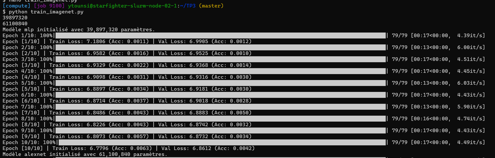
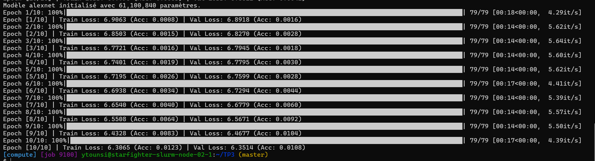

**Comparaison avec nos premières époques :**

| Modèle | Train Loss époque 1 | Val Loss époque 1 | Train Accuracy époque 1 | Val Accuracy époque 1 |
|---|---:|---:|---:|---:|
| MLP | 7.18 | 6.99 | 0.11 | 0.12 |
| AlexNet | 6.906 | 6.891 | 0.08 | 0.16 |


**Interprétation :** Les résultats de la première époque sont globalement proches des valeurs théoriques du hasard (accuracy de 0,1 % et CrossEntropy de 6,9078). AlexNet présente une loss quasiment identique à cette référence, tandis que celle du MLP est légèrement supérieure. Les deux modèles sont donc encore au début de leur apprentissage. Il faudra observer les époques suivantes pour vérifier si les pertes diminuent et les accuracies augmentent.

### 3.3. Comparaison MLP et AlexNet sur 20 000 images

**Protocole :** entraînement de chaque modèle sur `subset_size=20000`, pendant 10 époques au maximum, avec validation sur 5 000 images. Les deux modèles utilisent `CrossEntropyLoss`, l'optimiseur Adam et les mêmes pipelines de données, sauf les différences inhérentes aux architectures (notamment le Dropout d'AlexNet).

| Indicateur | MLP | AlexNet |
|---|---:|---:|
| Nombre d'époques effectuées | 10 | 10 |
| Train Loss finale | 6.779 | 6.306 |
| Val Loss finale | 6.861 | 6.351 |
| Train Accuracy finale | 0.63 | 1.23 |
| Val Accuracy finale | 0.42 | 1.08 |
| Meilleure Val Accuracy | 0.5 | 1.08 |

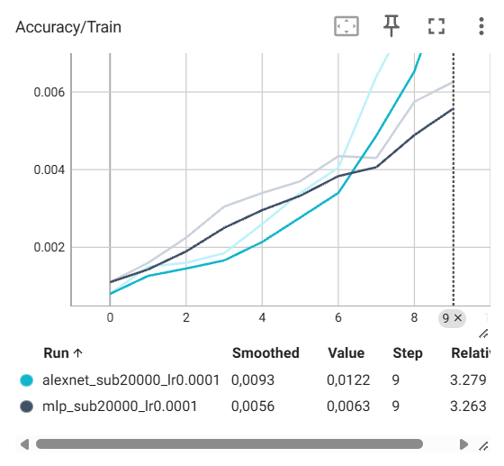
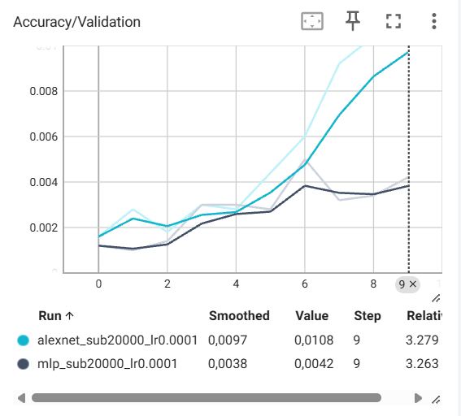
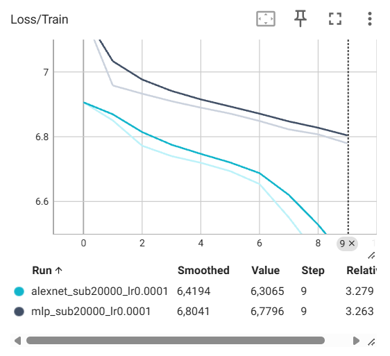
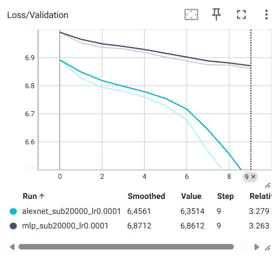


### Observation expérimentale : Modèle qui apprend le mieux

**AlexNet apprend mieux que le MLP.** Après 10 époques, AlexNet atteint une accuracy de validation de **1,08 %** contre **0,42 %** pour le MLP, et une validation loss de **6,351** contre **6,861**. Ses courbes montrent une diminution plus rapide de la loss et une augmentation plus importante de l'accuracy. Cela s'explique notamment par les convolutions, qui exploitent la structure spatiale des images.

### Observation expérimentale : Sur-apprentissage

**Le MLP présente davantage de signes de sur-apprentissage qu'AlexNet**, notamment à partir de la 6ᵉ époque : son accuracy d'entraînement continue d'augmenter alors que celle de validation stagne et fluctue autour de 0,35–0,42 %. L'écart train/validation est également plus important pour le MLP. Cependant, sa validation loss continue de diminuer, donc **aucun sur-apprentissage marqué n'est clairement observable** sur ces 10 époques. AlexNet, quant à lui, continue d'améliorer ses performances d'entraînement et de validation.

### 3.4. Impact de la profondeur : AlexNetDeep

Nous avons construit une variante d'AlexNet en ajoutant **trois couches de convolution `Conv2d(256, 256, kernel_size=3, padding=1)`**, chacune suivie de ReLU, **juste après Conv5 et avant le dernier MaxPooling**. Ces convolutions conservent les dimensions spatiales $13 \times 13$ et le nombre de canaux (256).

Chaque convolution supplémentaire apporte :

$$
(256\times3\times3+1)\times256=590\,080\text{ paramètres}.
$$

La variante possède donc :

$$
61\,100\,840+3\times590\,080=\boxed{62\,871\,080\text{ paramètres}}.
$$

Elle est entraînée avec `subset_size=20000` et 10 époques au maximum.

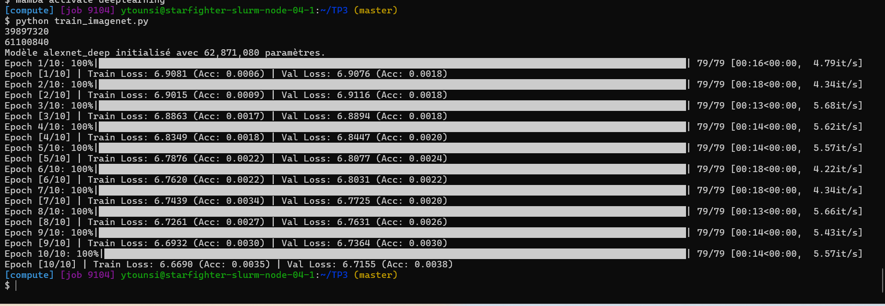

| Indicateur | AlexNet standard | AlexNetDeep |
|---|---:|---:|
| Paramètres | 61 100 840 | 62 871 080 |
| Train Loss finale | 6.306 | 6.669 |
| Val Loss finale | 6.351 | 6.715 |
| Train Accuracy finale | 1.23 | 0.35 |
| Val Accuracy finale | 1.08 | 0.38 |

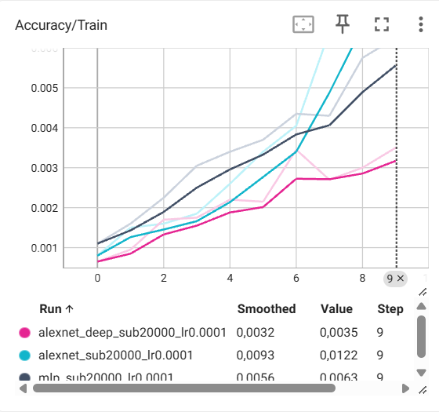
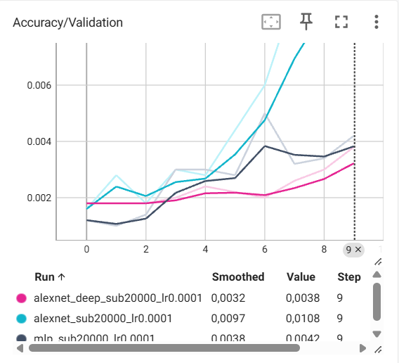

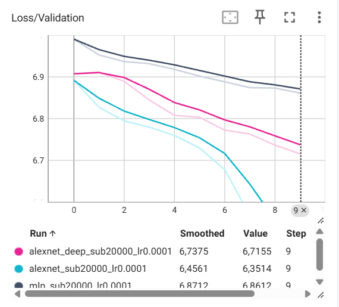

AlexNetDeep présente une difficulté d'optimisation et un sous-apprentissage par rapport à AlexNet standard. Après 10 époques, sa Train Loss reste plus élevée (6,669 contre 6,306) et son accuracy de validation est nettement inférieure (0,38 % contre 1,08 %). Bien que ses pertes diminuent progressivement, son apprentissage est plus lent, probablement en raison de la difficulté de propagation des gradients à travers les couches supplémentaires.

Il ne s'agit pas d'un sur-apprentissage, car les pertes d'entraînement et de validation continuent toutes deux de diminuer, sans divergence notable

---

## Exercice 4 - Entraînement long d'AlexNet sur ImageNet complet

### 4.1. Configuration de l'expérience sur le cluster

L'entraînement long utilise **AlexNet standard** sur l'intégralité d'ImageNet (`subset_size=None`), avec `num_epochs=50`. Le script est soumis avec `sbatch` à Slurm pour utiliser un nœud GPU sans conserver une session interactive ouverte.

| Paramètre | Configuration |
|---|---|
| Modèle | AlexNet standard |
| Dataset train | ImageNet ILSVRC 2012, environ 1,28 million d'images |
| Dataset validation | 50 000 images |
| Classes | 1 000 |
| Époques configurées | 50 |
| Époques effectivement terminées | 9  |
| Batch size | 256,  |
| Optimiseur | Adam |
| Learning rate | $10^{-4}$ |
| Weight decay | $10^{-5}$ |
| Early Stopping | Patience = 5 |

| Durée totale observée du job | 4h |

### 4.2. Profilage : durée d'une époque complète

La durée d'entraînement est mesurée avec `time.perf_counter()`, avant le début de l'époque et après le passage sur les batches d'entraînement. La durée complète incluant la validation peut également être relevée. 

### Mesures issues de nos logs
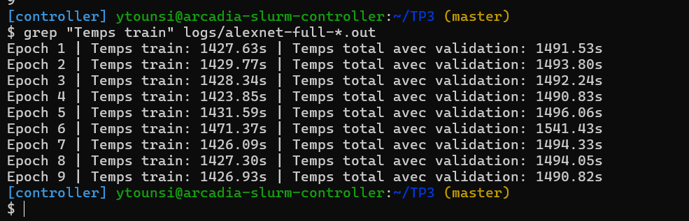

- **Durée de l'époque 1 (train uniquement) :** 1427,63 secondes, soit **23 min 47,63 s**.
- **Durée de l'époque 1 (train + validation) :** 1491,53 secondes, soit **24 min 51,53 s**.
- **Durée moyenne des époques (train uniquement) :** 1432,54 secondes, soit **23 min 52,54 s**.
- **Durée moyenne (train + validation) :** 1498,34 secondes, soit **24 min 58,34 s**.


### Interprétation

Une époque d'entraînement sur les 1,28 million d'images dure en moyenne **23 min 53 s**. En incluant la validation, la durée moyenne atteint environ **25 minutes**.

Ces durées dépendent notamment du GPU utilisé, du batch size, du nombre de workers et de la vitesse de chargement des images.

### 4.3. Estimation de la durée pour 100 époques sans Early Stopping

En supposant une durée moyenne constante et sans Early Stopping, nous estimons le temps nécessaire pour effectuer 100 époques à partir des 9 époques mesurées.

**Entraînement uniquement :**

- Durée moyenne d'une époque : 1432,54 secondes.
- Durée estimée pour 100 époques :

  **T = (1432,54 × 100) / 3600 ≈ 39,79 heures.**

**Entraînement avec validation :**

- Durée moyenne d'une époque : 1498,34 secondes.
- Durée estimée pour 100 époques :

  **T = (1498,34 × 100) / 3600 ≈ 41,62 heures.**

**Conclusion :** l'entraînement de 100 époques sur ImageNet nécessiterait environ **39 h 48 min** sans validation, et **41 h 37 min** en incluant la validation. Ces estimations supposent une vitesse d'exécution constante et l'absence d'Early Stopping.

### 4.4. Courbes d'entraînement sur le dataset complet
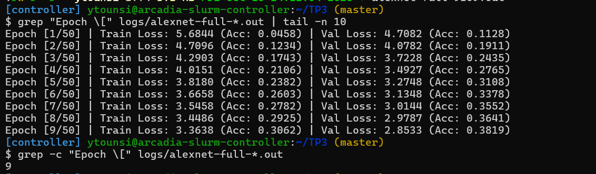

Les métriques suivies dans TensorBoard sont :

- **Loss/Train** : CrossEntropy moyenne sur les batches d'entraînement.
- **Loss/Validation** : CrossEntropy moyenne sur les données de validation.
- **Accuracy/Train** : proportion de prédictions correctes sur le train.
- **Accuracy/Validation** : proportion de prédictions correctes sur la validation.

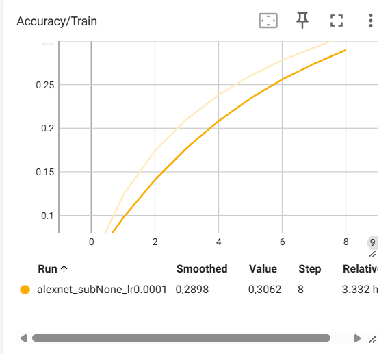
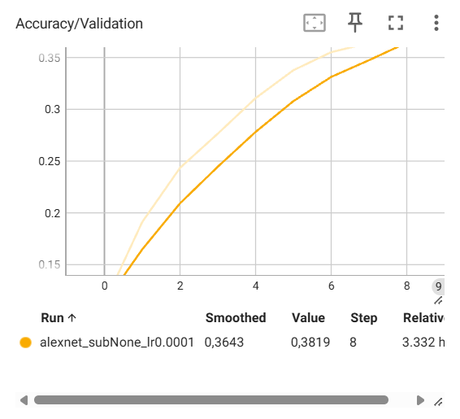
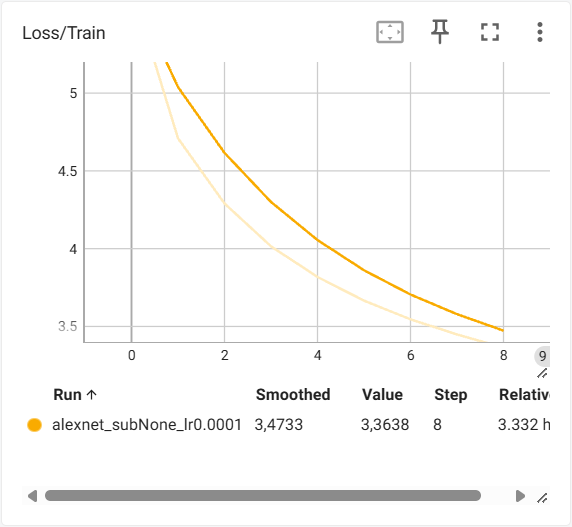
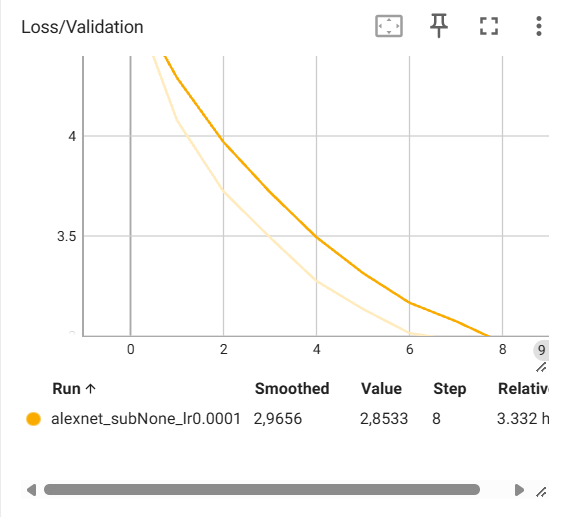

| Indicateur | Époque 1 | Dernière époque (9) | Meilleure valeur observée |
|---|---:|---:|---:|
| Loss/Train | 5,6844 | 3,3638 | 3,3638 (époque 9) |
| Loss/Validation | 4,7082 | 2,8533 | 2,8533 (époque 9) |
| Accuracy/Train | 4,58 % | 30,62 % | 30,62 % (époque 9) |
| Accuracy/Validation | 11,28 % | 38,19 % | 38,19 % (époque 9) |

**Observation expérimentale :**

Les résultats montrent un **apprentissage efficace et progressif** d'AlexNet sur ImageNet complet. Entre les époques 1 et 9, la Train Loss diminue de 5,6844 à 3,3638 et la Validation Loss de 4,7082 à 2,8533. Parallèlement, l'accuracy d'entraînement augmente de 4,58 % à 30,62 %, tandis que celle de validation passe de 11,28 % à 38,19 %.

La Validation Loss reste inférieure à la Train Loss, ce qui peut notamment s'expliquer par le Dropout et la Data Augmentation appliqués pendant l'entraînement.

**Conclusion :** les performances s'améliorent continuellement sur les 9 époques observées, sans signe de sur-apprentissage ni de plateau significatif. L'Early Stopping n'a pas été déclenché durant ces époques.

### 4.5. Comparaison de la généralisation : 20 000 images vs ImageNet complet

Pour comparer les deux entraînements d'AlexNet, nous examinons l'écart entre la loss de validation et la loss d'entraînement :

$$
\Delta L = L_{\mathrm{validation}} - L_{\mathrm{train}}
$$

L'expérience sur 20 000 images présente moins de diversité et beaucoup moins d'exemples uniques. Il est donc plus facile pour le modèle de mémoriser les spécificités des données d'entraînement, ce qui peut conduire à un sur-apprentissage plus rapide.

Sur ImageNet complet, le réseau rencontre davantage de variations d'objets, de cadrages et de contextes. Cette diversité, associée à la Data Augmentation, favorise généralement une meilleure généralisation.

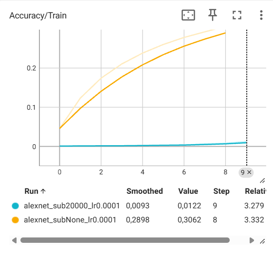
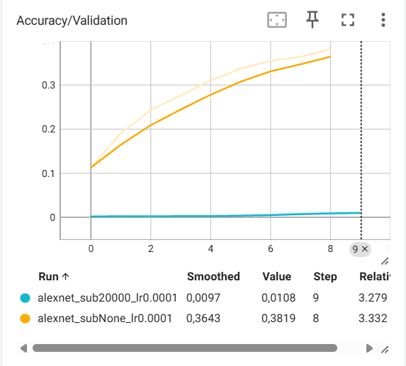
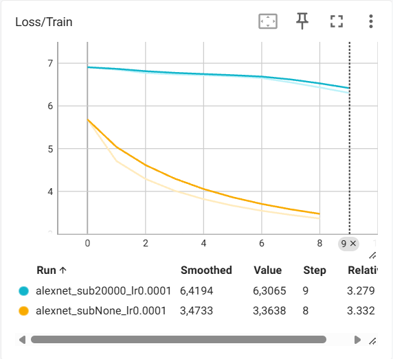
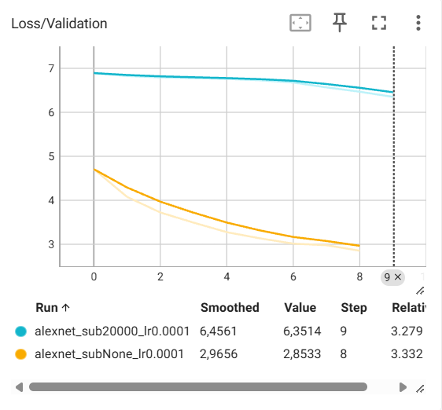


| Indicateur | 20 000 images | ImageNet complet |
|---|---:|---:|
| Nombre d'époques analysées | 10 | 9 |
| Loss/Train (dernière époque) | 6,3065 | 3,3638 |
| Loss/Validation (dernière époque) | 6,3514 | 2,8533 |
| Écart ΔL | +0,0449 | -0,5105 |
| Accuracy/Validation | 1,08 % | 38,19 % |

**Observation expérimentale :**

Sur le sous-ensemble de 20 000 images, l'écart entre les losses est légèrement positif (**+0,0449**), tandis qu'il est négatif sur ImageNet complet (**-0,5105**). De plus, l'accuracy de validation est nettement meilleure sur le dataset complet (**38,19 % contre 1,08 %**).

Ces résultats montrent qu'AlexNet apprend beaucoup plus efficacement sur ImageNet complet et ne présente pas de signe évident de sur-apprentissage durant les époques observées.

Cependant, la Validation Loss inférieure à la Train Loss sur ImageNet complet s'explique notamment par le Dropout et la Data Augmentation. Elle ne constitue donc pas, à elle seule, une preuve de meilleure généralisation. De plus, les deux expériences comportent un nombre d'époques et de mises à jour de poids très différent.

**Conclusion :** l'utilisation du dataset complet permet un apprentissage nettement plus efficace. Les résultats sont cohérents avec l'idée que la diversité des données réduit le risque de sur-apprentissage, même si les courbes observées ne suffisent pas à démontrer directement ce phénomène.

---

### 4.6. Pourquoi `Loss/Validation` peut-elle être inférieure à `Loss/Train` au début ?

Deux raisons techniques liées au code expliquent ce phénomène :

**1. Le Dropout est actif pendant l'entraînement, mais désactivé pendant la validation.**

Pendant l'entraînement, `model.train()` active `nn.Dropout(p=0.5)`, qui désactive aléatoirement certaines activations, rendant les prédictions plus difficiles.

Pendant la validation, `model.eval()` désactive le Dropout, ce qui peut produire une loss plus faible.

**2. La Data Augmentation est appliquée uniquement à l'entraînement.**

Pendant l'entraînement, `RandomResizedCrop` et `RandomHorizontalFlip` génèrent des variations parfois plus difficiles à classifier.

Pendant la validation, `Resize` et `CenterCrop` sont déterministes et peuvent produire des images plus faciles à reconnaître.

Enfin, la Train Loss est calculée pendant que les paramètres du modèle évoluent, tandis que la Validation Loss est évaluée avec les paramètres de fin d'époque.

Ainsi, une Validation Loss inférieure à la Train Loss ne signifie pas nécessairement qu'il existe une erreur ou une fuite de données.

---

## Conclusion générale

Ce TP nous a permis de comparer les architectures MLP et CNN pour la classification d'images sur ImageNet.

Sur le sous-ensemble de 20 000 images, **AlexNet obtient de meilleures performances que le MLP**, avec une accuracy de validation de **1,08 % contre 0,42 %**, grâce notamment à sa capacité à exploiter la structure spatiale des images.

L'ajout de trois couches convolutives dans AlexNetDeep a entraîné une **difficulté d'optimisation et un sous-apprentissage**, avec une accuracy de validation de **0,38 %**, montrant qu'augmenter la profondeur d'un réseau n'améliore pas nécessairement ses performances.

Sur ImageNet complet, AlexNet atteint **38,19 % d'accuracy de validation après 9 époques**, contre 11,28 % à la première époque, montrant une progression importante de l'apprentissage. La durée moyenne d'une époque d'entraînement est d'environ **23 min 53 s**, soit une estimation de **39,79 heures pour 100 époques**, sans compter la validation.

Enfin, ce TP a mis en évidence l'importance de la normalisation, de la Data Augmentation, du Dropout et de l'Early Stopping pour améliorer l'apprentissage et limiter le sur-apprentissage. Il a également permis d'étudier les compromis entre nombre de paramètres, mémoire des activations et performances des architectures.

**Limites :** les comparaisons restent dépendantes du nombre d'époques, de la quantité de données, des hyperparamètres et des ressources GPU disponibles.