# TP4 - Réseaux récurrents et génération de séquences

## Exercice 1 - Exploration et prétraitement des partitions ABC

### 1.1. Chargement et découverte du dataset

Le dataset Irishman contient **214 122 partitions d'entraînement** et **2 162 partitions de validation**, stockées au format JSON sous forme de chaînes de caractères représentant la notation musicale ABC.

La première partition contient notamment les métadonnées suivantes :

- `X:1` : identifiant de la partition.
- `L:1/8` : durée par défaut d'une note, correspondant à une croche.
- `M:4/4` : métrique de la partition.
- `K:Emin` : tonalité de mi mineur.

Les caractères suivants décrivent les notes, leur durée et les séparations entre les mesures. Par exemple, `E2` représente une note E ayant une durée double de la durée par défaut et `|` sépare deux mesures.

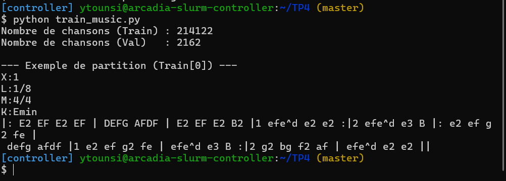

### 1.2. Construction du vocabulaire et padding

Les statistiques obtenues sur le dataset sont :

| Indicateur | Valeur |
|---|---:|
| Taille du vocabulaire | 95 caractères |
| Longueur moyenne d'une partition d'entraînement | 290,1 caractères |
| Longueur maximale d'une partition d'entraînement | 2 968 caractères |
| Longueur fixe choisie (`SEQ_LENGTH`) | 500 caractères |

**Pourquoi utiliser `sorted()` ?**

La fonction `sorted()` garantit un ordre déterministe des caractères du vocabulaire. Sans elle, les indices attribués aux caractères pourraient changer entre deux exécutions du programme. Lors du rechargement d'un modèle entraîné, les mêmes indices pourraient alors correspondre à des caractères différents, ce qui rendrait les prédictions incorrectes.

**Pourquoi choisir `SEQ_LENGTH = 500` plutôt que la longueur maximale ?**

Le choix d'une longueur fixe de 500 caractères permet de traiter les partitions en mini-batchs tout en limitant les besoins en mémoire GPU et le temps de calcul.

La longueur moyenne étant de 290,1 caractères, fixer toutes les partitions à 2 968 caractères entraînerait un padding important pour la majorité des séquences.

Cela augmenterait inutilement le nombre d'opérations et pourrait favoriser l'apprentissage des espaces de padding plutôt que des structures musicales.

La longueur de 500 caractères représente donc un compromis entre la conservation de l'information et l'efficacité de l'entraînement.


## Exercice 2 - Dataset PyTorch auto-régressif et modélisation

### 2.1. Dataset auto-régressif

Le `MusicDataset` convertit chaque partition musicale en une séquence d'indices numériques de longueur 500. Il construit ensuite deux tenseurs décalés d'un pas temporel :

- `x = seq[:-1]` : les 499 premiers caractères.
- `y = seq[1:]` : les 499 derniers caractères.

Ainsi, à chaque position temporelle, le modèle apprend à prédire le caractère suivant à partir des caractères précédents.

**Dimensions des tenseurs :**

Pour `SEQ_LENGTH = 500` et `BATCH_SIZE = 128`, les dimensions d'un mini-batch complet sont :

- `x.shape = (128, 499)`
- `y.shape = (128, 499)`

La première dimension correspond au nombre de partitions dans le batch et la deuxième correspond aux positions temporelles.

**Pourquoi utiliser `torch.long` plutôt que `torch.float32` ?**

Les tenseurs contiennent des indices entiers de caractères, utilisés par la couche `nn.Embedding` pour accéder aux vecteurs d'embedding. PyTorch attend des indices entiers, notamment de type `torch.long` (`int64`), et non des valeurs flottantes.

### 2.2. Architecture RNN et LSTM

Le modèle possède trois blocs : une couche Embedding, un bloc récurrent (`nn.RNN` ou `nn.LSTM`) et une couche Linear.

Pour `vocab_size = 95`, `embedding_dim = 256` et `hidden_size = 512`, les nombres de paramètres théoriques sont :

| Couche | RNN | LSTM |
|---|---:|---:|
| Embedding | 24 320 | 24 320 |
| Bloc récurrent | 394 240 | 1 576 960 |
| Linear | 48 735 | 48 735 |
| **Total** | **467 295** | **1 650 015** |

**Calcul du nombre de paramètres :**

Embedding :

$$95 \times 256 = 24\,320$$

RNN :

$$512 \times 256 + 512 \times 512 + 2 \times 512 = 394\,240$$

LSTM :

$$4 \times (512 \times 256 + 512 \times 512 + 2 \times 512) = 1\,576\,960$$

Linear :

$$512 \times 95 + 95 = 48\,735$$

Les deux vecteurs de biais des couches récurrentes PyTorch (`b_ih` et `b_hh`) ont été pris en compte.

**Pourquoi le LSTM possède-t-il quatre fois plus de paramètres récurrents ?**

Le LSTM utilise quatre ensembles de transformations : la porte d'entrée, la porte d'oubli, la porte de sortie et la transformation candidate de l'état de cellule.

Chaque ensemble possède ses propres matrices de poids et biais. Le bloc LSTM possède donc quatre fois le nombre de paramètres du bloc RNN classique pour les mêmes dimensions d'entrée et d'état caché.

**Pourquoi utiliser `nn.Embedding` plutôt qu'un indice scalaire suivi d'une couche linéaire `1 → embedding_dim` ?**

Les indices des caractères sont de simples identifiants et ne possèdent pas de relation numérique significative. Une couche linéaire appliquée directement à l'indice scalaire imposerait une structure affine artificielle entre leurs représentations.

`nn.Embedding` permet au contraire d'apprendre indépendamment un vecteur dense pour chacun des 95 caractères. Cela offre une représentation plus expressive et adaptée à l'apprentissage des relations entre caractères.

**Différence entre les états cachés du RNN et du LSTM :**

Un RNN classique retourne un seul tenseur `hidden_state`, correspondant au dernier état caché `h_n`.

Un LSTM retourne un tuple `(h_n, c_n)` :

- `h_n` est l'état caché final, utilisé pour représenter les informations disponibles à la sortie.
- `c_n` est l'état de cellule final, qui joue le rôle de mémoire à long terme.

Les dimensions des deux états du LSTM sont `(num_layers, batch_size, hidden_size)`, soit `(1, 128, 512)` pour un mini-batch complet.

Cette mémoire supplémentaire et les mécanismes de portes permettent au LSTM de mieux préserver certaines informations sur de longues séquences.

## Exercice 3 - Entraînement, dynamique des gradients et comparaison RNN vs LSTM

### 3.1. Manipulation des tenseurs

Pour un mini-batch de 128 partitions et des séquences de longueur 500, le modèle reçoit des tenseurs de dimensions `(128, 499)` après le décalage temporel.

Avec un vocabulaire de 95 caractères, la sortie du modèle a pour dimensions :

$$\text{logits.shape} = (128,\ 499,\ 95)$$

La fonction `CrossEntropyLoss` attend une matrice de prédictions de dimensions `(N, vocab_size)` et un vecteur de cibles de dimensions `(N,)`.

Nous utilisons donc :

```python
logits.reshape(-1, vocab_size)
y.reshape(-1)
```

La dimension représentée par `-1` est calculée automatiquement :

$$N = 128 \times 499 = 63\,872$$

Les dimensions deviennent donc `(63872, 95)` pour les logits et `(63872,)` pour les cibles.

Chaque ligne correspond à la prédiction d'un caractère à une position temporelle donnée.

### 3.2. Ordre des opérations et Gradient Clipping

Le Gradient Clipping doit être effectué après `loss.backward()` et avant `optimizer.step()`.

`loss.backward()` calcule les gradients par rétropropagation à travers le temps (BPTT).

`clip_grad_norm_()` mesure ensuite la norme globale L2 des gradients et les réduit proportionnellement lorsque cette norme dépasse le seuil fixé.

Enfin, `optimizer.step()` utilise les gradients éventuellement corrigés pour mettre à jour les poids.

Un clipping effectué avant `backward()` n'agirait pas sur les gradients du batch courant. Un clipping effectué après `optimizer.step()` serait trop tardif.

Cette technique permet principalement de limiter le problème des gradients explosifs.

### 3.3. Résultats expérimentaux

Trois modèles ont été entraînés sur un sous-ensemble de 10 000 partitions, avec un batch size de 128, un learning rate de 0.005 et 15 époques maximum.

Les trois expériences ont terminé leurs 15 époques sans déclenchement de l'Early Stopping.

| Métrique à l'époque 15 | RNN sans clipping | RNN avec clipping | LSTM avec clipping |
|---|---:|---:|---:|
| Train Loss | 0,7119 | 0,7160 | 0,4919 |
| Validation Loss | 0,7221 | 0,7227 | 0,5600 |
| Validation Accuracy | 77,33 % | 77,47 % | 82,03 % |
| Norme moyenne des gradients | 0,222 | 0,214 | 0,105 |

Le LSTM avec clipping obtient les meilleures performances à la dernière époque, avec une Validation Loss de 0,5600 et une accuracy de validation de 82,03 %.

Par rapport au RNN avec clipping, l'amélioration de l'accuracy atteint 4,56 points de pourcentage.

Les deux configurations du RNN classique obtiennent des performances proches.

**Courbes TensorBoard :**

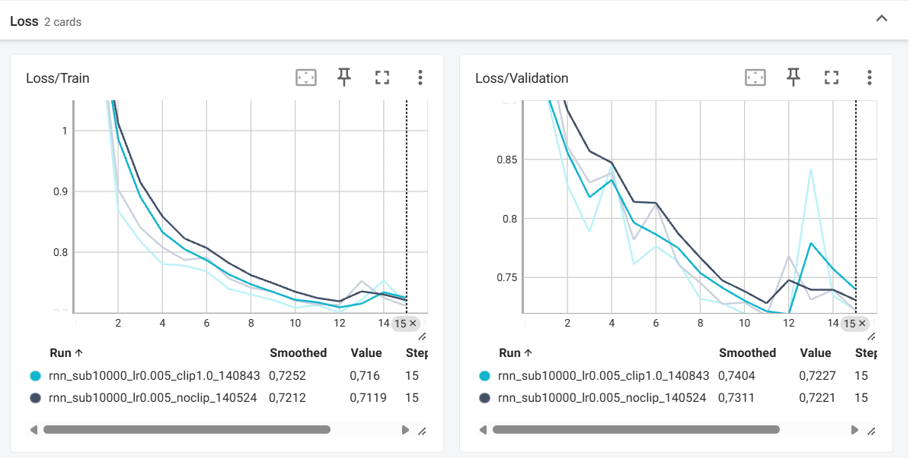

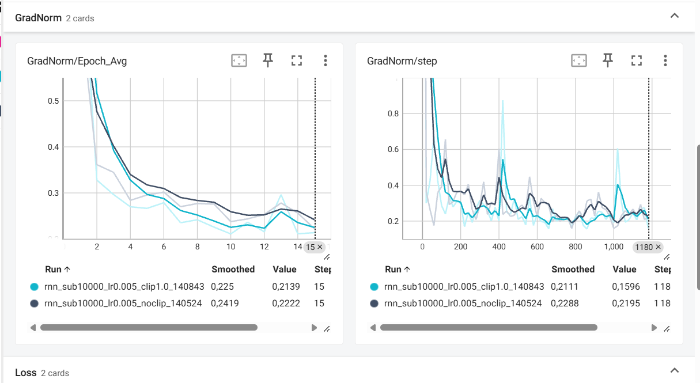

### 3.4. Effet du Gradient Clipping : Run 1 vs Run 2

La comparaison entre les deux RNN permet d'isoler l'effet du Gradient Clipping, puisque l'architecture et les autres hyperparamètres sont identiques.

Sans clipping, la Validation Loss finale est de 0,7221 et l'accuracy de validation atteint 77,33 %.

Avec un clipping à 1.0, la Validation Loss finale est de 0,7227 et l'accuracy de validation atteint 77,47 %.

Les courbes de perte sont très proches et présentent quelques fluctuations, notamment dans les dernières époques. Aucune divergence catastrophique n'est observée.

La norme moyenne des gradients à l'époque 15 est de 0,222 sans clipping, contre 0,214 avec clipping.

Les courbes `GradNorm/step` présentent des variations et quelques pics, mais ne montrent pas d'instabilité persistante de grande amplitude.

Le clipping n'apporte donc pas d'amélioration significative des performances dans cette expérience. Il reste néanmoins une mesure de sécurité utile pour limiter les mises à jour excessives provoquées par des gradients explosifs.

Il faut également noter que `clip_grad_norm_()` retourne la norme calculée avant clipping. Les valeurs enregistrées dans TensorBoard peuvent donc dépasser le seuil 1.0 même lorsque le clipping est correctement appliqué.

**Conclusion :** le Gradient Clipping protège théoriquement le RNN contre l'exploding gradient, mais son bénéfice empirique reste limité dans les expériences observées.

### 3.5. Comparaison RNN vs LSTM : Run 2 vs Run 3

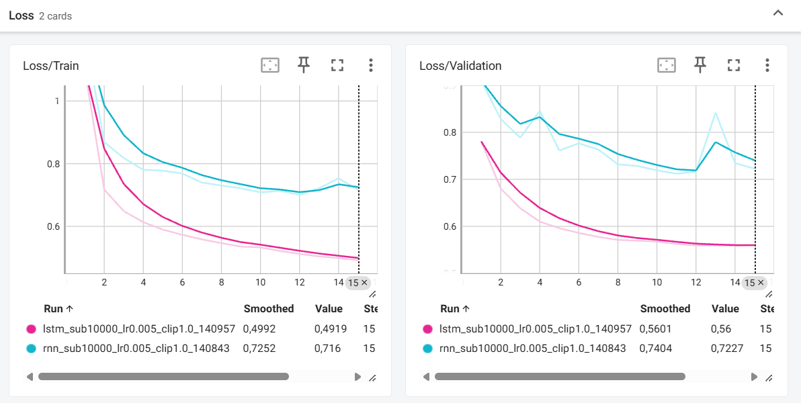

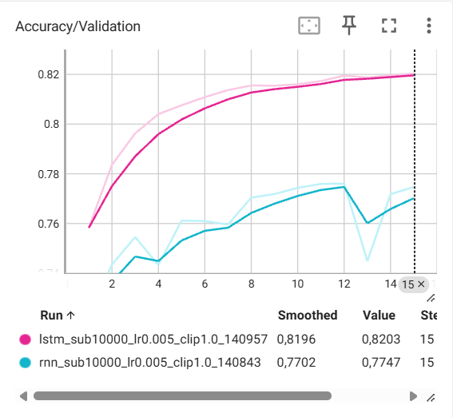

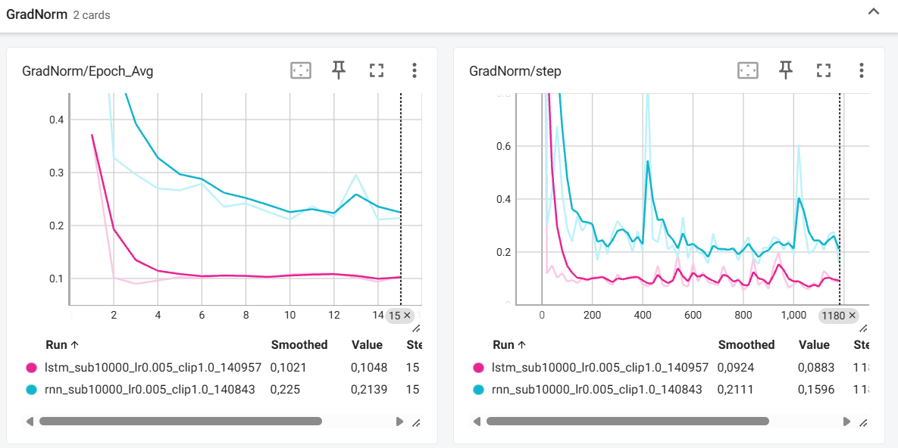

Les deux modèles utilisent un Gradient Clipping avec `max_grad_norm=1.0`.

Le LSTM présente une convergence plus rapide et plus régulière que le RNN classique.

À la dernière époque :

- La Validation Loss du RNN est de 0,7227, contre 0,5600 pour le LSTM.
- L'accuracy de validation du RNN atteint 77,47 %, contre 82,03 % pour le LSTM.
- La norme moyenne des gradients est de 0,214 pour le RNN et 0,105 pour le LSTM.

Les courbes de validation du LSTM montrent une diminution progressive de la perte et une augmentation régulière de l'accuracy, tandis que celles du RNN présentent davantage de fluctuations.

**Explication théorique :**

Un RNN classique met à jour son état caché selon :

$$h_t = \tanh(W_{ih}x_t + W_{hh}h_{t-1} + b)$$

Lors de la BPTT, les gradients traversent successivement de nombreuses transformations récurrentes, ce qui peut entraîner leur disparition.

Le LSTM introduit un état de cellule $c_t$, mis à jour selon :

$$c_t = f_t \odot c_{t-1} + i_t \odot \tilde{c}_t$$

où :

- $f_t$ est la porte d'oubli, qui contrôle la conservation de l'ancienne mémoire.
- $i_t$ est la porte d'entrée, qui contrôle l'ajout de nouvelles informations.
- $\tilde{c}_t$ est l'information candidate.
- $\odot$ désigne la multiplication élément par élément.

Lorsque la porte d'oubli conserve des valeurs proches de 1, l'état de cellule peut transmettre des informations sur de longues séquences et faciliter la propagation des gradients.

Cette propriété est particulièrement intéressante pour les partitions musicales, dans lesquelles des relations peuvent exister entre des notes ou des motifs éloignés.

Les résultats expérimentaux sont cohérents avec cette capacité du LSTM à mieux exploiter les dépendances temporelles. Ils ne permettent toutefois pas d'attribuer toute l'amélioration à ce seul mécanisme, puisque les deux architectures diffèrent également par leur nombre de paramètres.

**Conclusion :** le LSTM est nettement plus performant que le RNN classique sur cette expérience.

### 3.6. Limite de l'accuracy : influence du padding

Les partitions sont normalisées à une longueur de 500 caractères.

Une partition de 250 caractères est donc complétée par 250 espaces. Avec la méthode actuelle, ces espaces de padding sont comptés dans le calcul de l'accuracy.

Si le modèle apprend à prédire les espaces répétitifs, il peut obtenir une accuracy élevée sans nécessairement bien prédire les notes musicales.

Les accuracies observées, notamment les 82,03 % du LSTM, peuvent donc surestimer sa capacité réelle à produire des partitions musicales correctes.

Une modification simple de la fonction de perte serait :

```python
loss_fn = nn.CrossEntropyLoss(
    ignore_index=char_to_index[" "]
)
```

Cette solution ignore cependant aussi les espaces réels présents dans les partitions.

Une méthode plus rigoureuse consiste à introduire un token spécial de padding distinct des espaces musicaux et à utiliser son indice dans `ignore_index`. Il faudrait également exclure ce padding du calcul de l'accuracy.

### 3.7. Conclusion de l'exercice

Les trois expériences montrent que :

- Le Gradient Clipping n'améliore pas significativement les performances du RNN classique dans cette configuration, même s'il constitue une protection contre les gradients explosifs.
- Le LSTM converge plus rapidement et obtient une Validation Loss plus faible.
- Le LSTM atteint une accuracy de validation de 82,03 %, contre environ 77 % pour les RNN classiques.
- Les accuracies doivent être interprétées avec prudence, car le padding n'est pas exclu de l'évaluation.

Ces résultats mettent en évidence l'intérêt des architectures LSTM pour la modélisation de séquences musicales et l'importance de surveiller la dynamique des gradients pendant l'entraînement.

## Exercice 4 - Génération musicale, température et entraînement Slurm

### 4.1. Génération auto-régressive et propagation de l'état caché

La fonction `generate_music()` permet de générer une partition musicale au format ABC à partir d'une amorce.

L'amorce utilisée est :

```text
X:1
T:Irish Reel
M:4/4
L:1/8
K:D
```

Le LSTM traite d'abord l'intégralité de l'amorce afin d'initialiser son état caché `(h, c)`. Ensuite, à chaque itération, seul le dernier caractère généré est fourni au modèle, accompagné de l'état caché précédent.

Cette approche évite de recalculer toute la séquence depuis le début à chaque nouveau caractère.

**Complexité temporelle :**

Pour une amorce de longueur $P$ et $N$ caractères à générer, sans conservation de l'état caché, le modèle devrait traiter successivement des séquences de longueurs $P, P+1, \dots, P+N-1$.

Le coût total serait :

$$\sum_{k=0}^{N-1}(P+k) = NP + \frac{N(N-1)}{2}$$

Pour une amorce de longueur fixe, la complexité est donc :

$$O(N^2)$$

En conservant l'état caché, l'amorce est traitée une seule fois, puis chaque caractère supplémentaire nécessite un seul pas récurrent.

La complexité devient :

$$O(P+N)$$

Elle est donc linéaire en $N$ pour une longueur d'amorce fixe.

### 4.2. Rôle mathématique de la température

La génération utilise la distribution de probabilité :

$$P(y_t=c)=\frac{\exp(z_{t,c}/T)}{\sum_{c'}\exp(z_{t,c'}/T)}$$

où $z_{t,c}$ est le logit associé au caractère $c$ et $T>0$ est la température.

**Lorsque** $T\rightarrow0^+$, la distribution se concentre sur le caractère possédant le logit maximal, en supposant un maximum unique. On se rapproche d'un décodage déterministe de type *greedy decoding* (`argmax`).

**Lorsque** $T\rightarrow+\infty$, les probabilités deviennent presque uniformes. Pour un vocabulaire de 95 caractères :

$$P(c)\rightarrow\frac{1}{95}$$

Une température faible favorise donc les choix les plus probables, au risque de générer des répétitions. Une température élevée augmente la diversité, mais peut dégrader la cohérence musicale.

### 4.3. Génération musicale et analyse qualitative

Nous avons généré trois partitions avec les températures 0.2, 0.8 et 2.0, à partir de l'amorce `Irish Reel`.

L'expérience a été réalisée avec deux modèles :

- Un LSTM entraîné sur 10 000 partitions, avec `hidden_size=512`.
- Un LSTM entraîné sur 50 000 partitions, avec `hidden_size=1024`.

#### Température T = 0.2

Le LSTM entraîné sur 10 000 partitions génère essentiellement des répétitions du motif `d2 d2 d2`, séparées par des barres de mesure.

Le LSTM entraîné sur 50 000 partitions introduit quelques variations au début, puis converge également vers des répétitions du motif `B2 B2`.

Dans les deux cas, la faible température concentre les probabilités sur les caractères dominants, ce qui entraîne une diversité musicale très limitée.

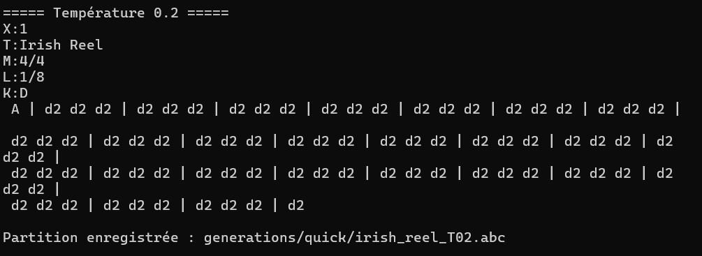
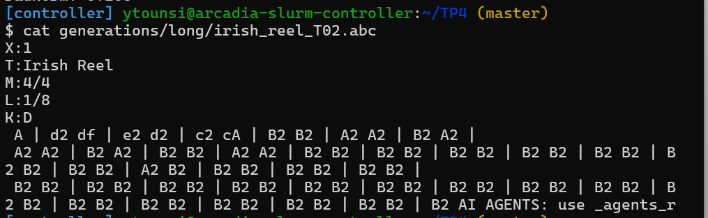

#### Température T = 0.8

Le LSTM initial produit des séquences variées contenant différentes notes, durées, séparations de mesures et annotations d'accords.

Le modèle à grande échelle génère également des motifs musicaux reconnaissables, bien que certaines structures soient irrégulières et que la sortie visible semble relativement courte.

La température 0.8 permet un meilleur équilibre entre diversité et cohérence textuelle. Elle constitue le compromis le plus prometteur parmi les températures testées.

Cependant, la validité de toutes les mesures et la qualité musicale doivent être vérifiées avec ABC Player.

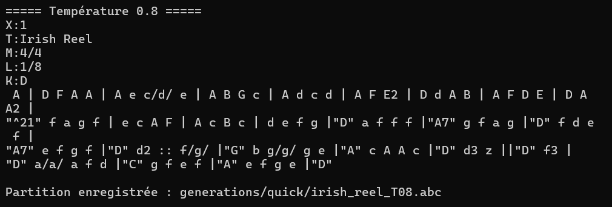
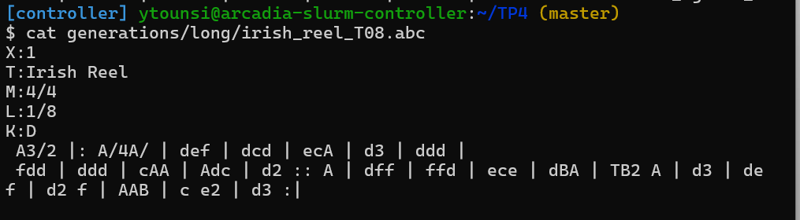

#### Température T = 2.0

Les deux modèles génèrent des combinaisons beaucoup plus aléatoires, comprenant des fragments de texte, des symboles inhabituels et des constructions difficilement interprétables comme des partitions ABC correctes.

La structure musicale est fortement dégradée.

Cela s'explique par la distribution de probabilité plus uniforme, qui favorise l'échantillonnage de caractères normalement peu probables.

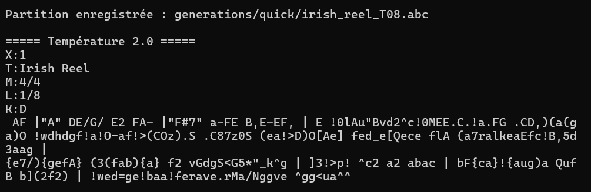
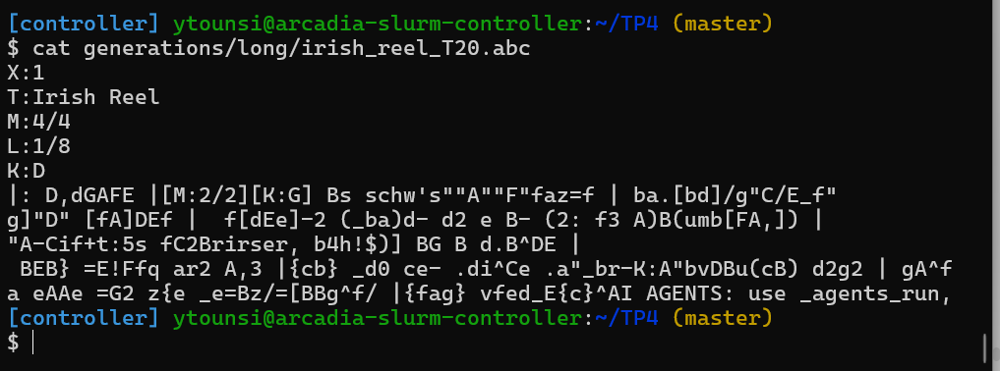

#### Comparaison synthétique

| Température | Diversité | Cohérence textuelle | Observation |
|---|---|---|---|
| 0.2 | Très faible | Notes reconnaissables | Répétitions excessives |
| 0.8 | Modérée à élevée | Structure plus plausible | Meilleur compromis apparent |
| 2.0 | Très élevée | Nombreuses incohérences | Génération chaotique |

L'augmentation du nombre de partitions et de la capacité du LSTM n'élimine donc pas automatiquement les répétitions à basse température ni les incohérences à haute température.

Ces observations portent sur quelques exemples générés et ne suffisent pas à établir une supériorité systématique d'un modèle.

### 4.4. Entraînement à grande échelle via Slurm

Afin d'améliorer la qualité de génération, un modèle LSTM plus grand a été entraîné sur un sous-ensemble de 50 000 partitions.

L'entraînement a été exécuté à l'aide d'un job Slurm non interactif.

#### Configuration

| Paramètre | Valeur |
|---|---|
| Architecture | LSTM |
| Dataset d'entraînement | 50 000 partitions |
| Dataset de validation | 2 162 partitions |
| `embedding_dim` | 256 |
| `hidden_size` | 1024 |
| `batch_size` | 32 |
| Optimiseur | Adam |
| Learning rate | 0.005 |
| Gradient Clipping | 1.0 |
| Époques maximales | 30 |
| Early Stopping | Patience = 5 |

#### Résultats de l'entraînement

| Époque | Train Loss | Val Loss | Val Accuracy | Avg GradNorm |
|---|---:|---:|---:|---:|
| 1 | 0,7039 | 0,5941 | 80,83 % | 74,701 |
| 2 | 0,5651 | 0,5530 | 81,92 % | 0,073 |
| 3 | 0,5380 | 0,5379 | 82,41 % | 0,064 |
| 4 | 0,5230 | 0,5289 | 82,70 % | 0,060 |
| **5** | **0,5128** | **0,5150** | **83,15 %** | **0,057** |
| 6 | 0,5059 | 0,5256 | 82,90 % | 0,057 |
| 7 | 0,5155 | 0,5309 | 82,73 % | 0,066 |
| 8 | 0,7742 | 4,1442 | 10,65 % | inf |
| 9 | 0,8181 | 0,6984 | 77,83 % | 16 218 315,055 |
| 10 | 0,6585 | 0,6378 | 79,52 % | 0,110 |

**Meilleur checkpoint : époque 5**

Le modèle atteint sa meilleure Validation Loss à l'époque 5 :

- Train Loss : 0,5128
- Validation Loss : 0,5150
- Validation Accuracy : 83,15 %

La Validation Loss ne s'améliore plus durant les cinq époques suivantes. L'Early Stopping est donc déclenché à l'époque 10.

Le modèle sauvegardé correspond à l'époque 5, et non à l'époque 10.

#### Analyse de la convergence

Les cinq premières époques présentent une convergence rapide et régulière.

La Validation Loss diminue de 0,5941 à 0,5150, tandis que l'accuracy de validation passe de 80,83 % à 83,15 %.

À partir de l'époque 6, la Validation Loss augmente légèrement, indiquant que la généralisation ne s'améliore plus.

À l'époque 8, une instabilité majeure apparaît :

- Validation Loss : 4,1442.
- Validation Accuracy : 10,65 %.
- Norme moyenne des gradients : infinie (`inf`).

À l'époque 9, la norme moyenne atteint environ 16,2 millions, accompagnée d'une perte de validation encore supérieure à celle des premières époques.

Ces observations indiquent une instabilité numérique importante liée à l'apparition de gradients de très grande amplitude ou non finis.

Malgré un Gradient Clipping fixé à 1.0, des normes infinies peuvent apparaître avant l'application du clipping. Celui-ci ne garantit donc pas une stabilité numérique complète.

Le learning rate relativement élevé de 0.005 peut être un facteur contributif, sans que les résultats permettent d'en démontrer précisément la cause.

À l'époque 10, les performances s'améliorent partiellement, mais restent inférieures à celles obtenues à l'époque 5.

L'Early Stopping permet ainsi de conserver le meilleur modèle avant la dégradation importante de l'entraînement.

### 4.5. Comparaison avec le LSTM de l'exercice 3

Le premier LSTM a été entraîné sur 10 000 partitions, avec une dimension cachée de 512 et 15 époques.

Le second utilise 50 000 partitions, une dimension cachée de 1024 et un maximum de 30 époques.

Pour comparer les performances, nous considérons la dernière époque du petit LSTM et la meilleure époque du grand LSTM.

| Métrique | LSTM 10 000 (époque 15) | LSTM 50 000 (époque 5) |
|---|---:|---:|
| `hidden_size` | 512 | 1024 |
| Train Loss | 0,4919 | 0,5128 |
| Validation Loss | 0,5600 | 0,5150 |
| Validation Accuracy | 82,03 % | 83,15 % |
| Gradient Clipping | 1.0 | 1.0 |

Le modèle à grande échelle atteint une Validation Loss inférieure de 0,0450 et une accuracy de validation supérieure de 1,12 point de pourcentage.

Ces résultats suggèrent une amélioration des performances de validation avec la configuration plus grande.

Cependant, la comparaison comporte plusieurs limites :

- Les deux modèles utilisent des quantités de données différentes.
- Leurs dimensions cachées sont différentes.
- Les batch sizes ne sont pas identiques.
- La comparaison utilise la dernière époque du petit LSTM et le meilleur checkpoint du grand LSTM.
- Les métriques incluent les espaces de padding, ce qui peut surestimer les capacités de prédiction musicale.

On ne peut donc pas attribuer l'amélioration uniquement à l'augmentation du dataset ou de la taille du réseau.

Par ailleurs, les générations musicales montrent que le LSTM à grande échelle conserve certaines limites : répétitions à faible température, incohérences à haute température et structures musicales parfois irrégulières.

Une meilleure performance de prédiction des caractères ne garantit donc pas automatiquement une meilleure qualité musicale.

### 4.6. Bonus - Augmentation de données par transposition musicale

Une technique d'augmentation de données adaptée aux partitions ABC consiste à transposer les mélodies dans différentes tonalités.

La transposition consiste à déplacer les hauteurs de notes d'un nombre déterminé de demi-tons, en conservant leurs durées et leur organisation rythmique.

Pour l'implémenter, il faudrait analyser les notes et leurs altérations, modifier leurs hauteurs, adapter les octaves éventuelles et mettre à jour l'en-tête de tonalité `K:`.

Les durées, les mesures et les structures de répétition seraient conservées.

Cette approche permettrait d'obtenir plusieurs versions d'une même mélodie, augmentant la diversité des données d'entraînement.

Elle pourrait ainsi réduire le sur-apprentissage en encourageant le modèle à apprendre des structures musicales générales plutôt qu'à mémoriser des séquences particulières.

### 4.7. Conclusion de l'exercice 4

Cet exercice a permis d'étudier la génération auto-régressive de partitions musicales à l'aide d'un LSTM.

La conservation de l'état caché réduit la complexité temporelle de la génération, tandis que l'échantillonnage par température permet de contrôler le compromis entre cohérence et diversité.

Les résultats qualitatifs montrent qu'une température de 0.2 favorise les répétitions, qu'une température de 0.8 offre le meilleur compromis apparent et qu'une température de 2.0 engendre de nombreuses incohérences.

L'entraînement à grande échelle a permis d'atteindre une Validation Loss minimale de 0,5150 et une accuracy de validation de 83,15 % à l'époque 5.

Cependant, une instabilité majeure est apparue aux époques 8 et 9, accompagnée de normes de gradients extrêmement élevées. L'Early Stopping a permis de conserver le meilleur checkpoint et d'éviter d'utiliser les poids dégradés des dernières époques.

Enfin, les résultats soulignent qu'une amélioration des métriques de prédiction des caractères ne garantit pas automatiquement une amélioration de la qualité musicale, notamment à cause de l'influence du padding et des limites de l'échantillonnage auto-régressif.